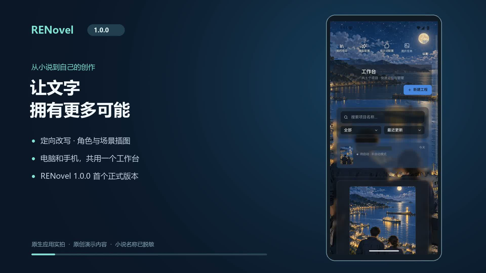
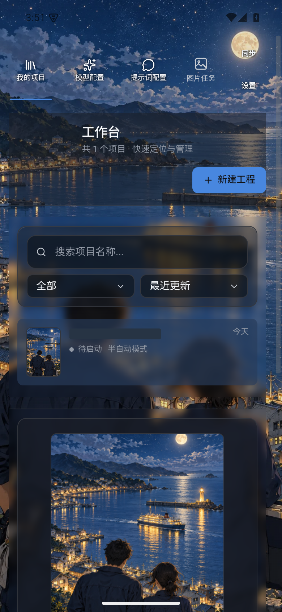
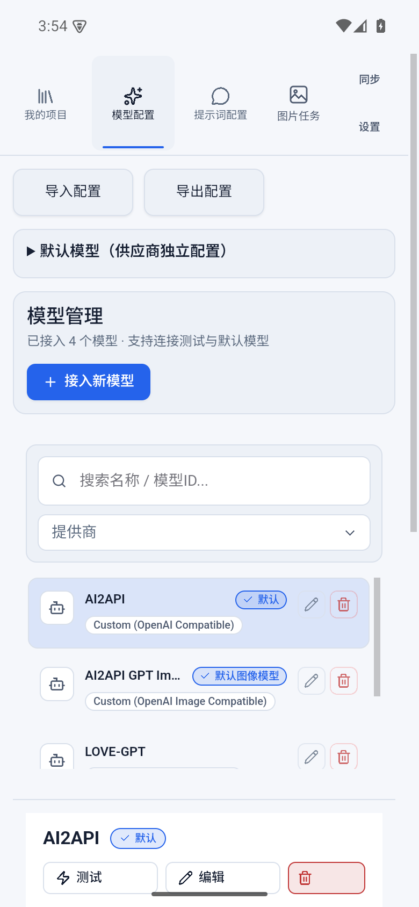
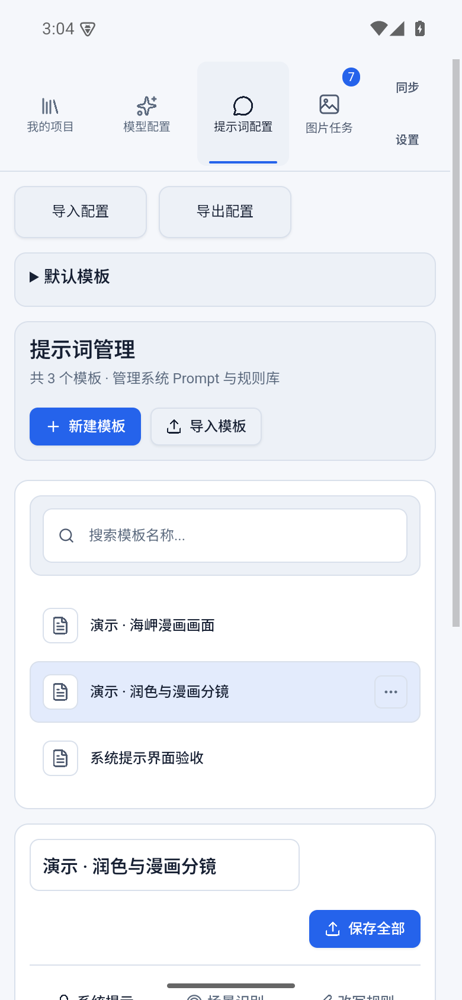
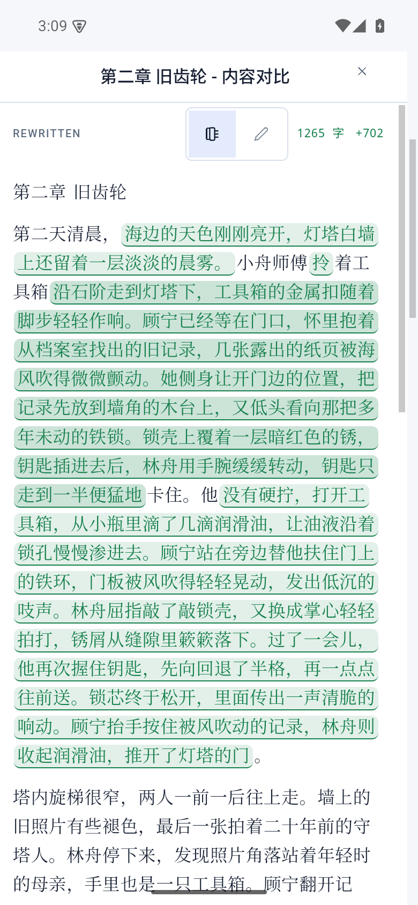
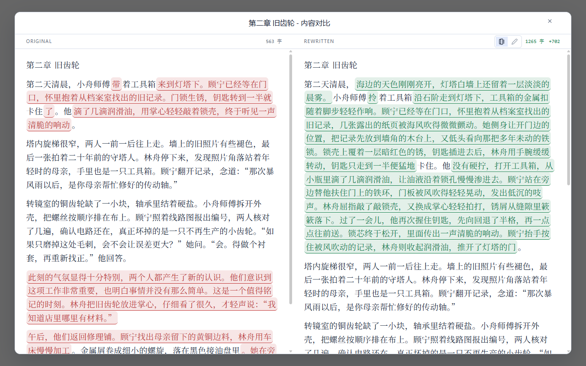
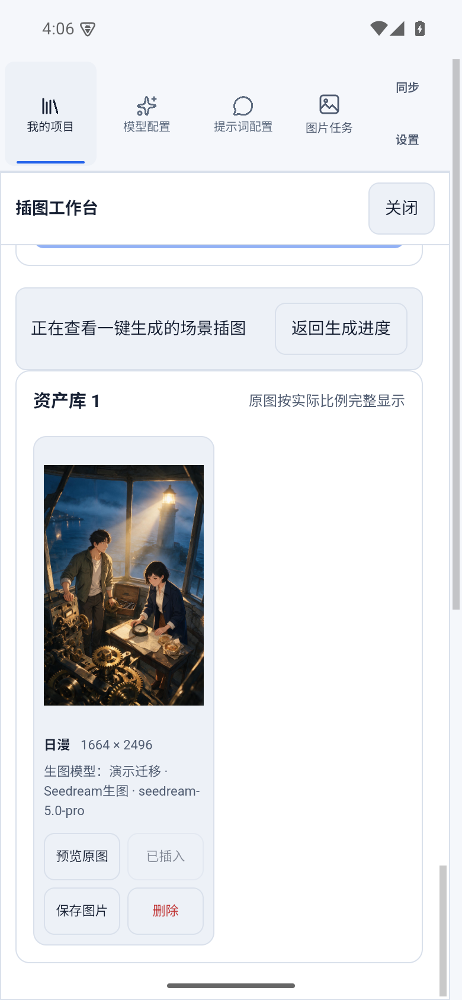
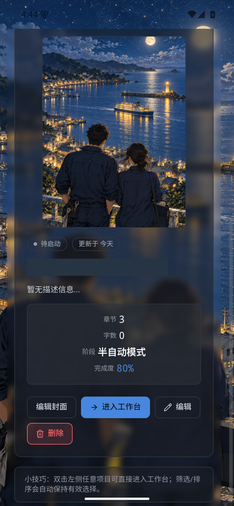
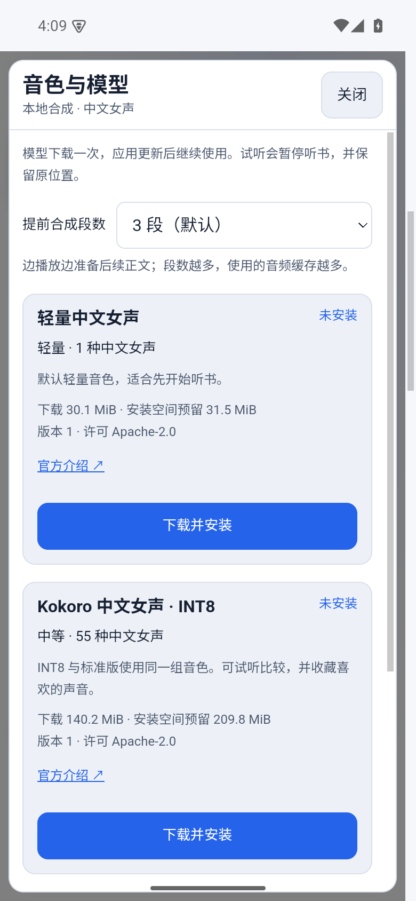

# RENovel

**把小说分析、定向改写、角色立绘、场景插图和离线听书放进同一个工作台。**

RENovel 是面向 Windows 与 Android 的小说创作辅助工具。接入自己的模型，编写适合自己的模板，可用于去 AI 味与润色、小说配图，以及半自动漫画分镜制作。项目、正文和图片保存在本机；模型调用会将任务所需内容发送到所配置的服务。

**1.0.0 首个正式版本 · 电脑手机同步 · 软件内升级 · 语音模型按需下载**

[下载 Windows / Android](https://github.com/while4234/renovel-releases/releases/latest) · [国内下载](https://gitee.com/RondleLiu/renovel-releases/releases) · [使用教程](#使用教程)

## 两分钟视频介绍

**点击封面观看或下载视频。** 通过真实界面、双端改写对比和图文动画介绍主要功能，配原创背景音乐，无语音解说。[直接打开视频](https://github.com/while4234/renovel-releases/releases/download/v1.0.0/Renovel_1.0.0_intro_zh-CN.mp4) · [国内视频入口](https://gitee.com/RondleLiu/renovel-releases/releases/download/v1.0.0/Renovel_1.0.0_intro_zh-CN.mp4)

## 能做什么

| 功能 | 用途 |
| --- | --- |
| 项目与 TXT 导入 | 编码识别、章节拆分预览、搜索排序、进度统计、项目独立配置 |
| 多模型连接 | 支持 OpenAI 兼容、Responses、Anthropic、Ollama；文本与图片分开配置 |
| 自定义模板 | 自定义总结、识别类别、通用及分类改写规则、绘图要求；支持导入导出 |
| 自动与半自动处理 | 总结、识别、字数规划、改写、合并输出；并发、重试、停止与恢复 |
| 场景定向改写 | 依据原文位置改写，应用对应规则与预算，保留范围外正文 |
| 角色资料库 | 姓名、别名、描述、出现章节与出现率，支持搜索和编辑 |
| 手动与智能合并 | 整理同一人物的不同称呼；审核模型建议后合并资料及图片关联 |
| 角色立绘 | 文生图、图生图、批量生成、出现率筛选、多版本与主立绘管理 |
| 封面与场景插图 | 封面上传/生成、参考角色立绘、编辑绘图提示词、正文插图 |
| 一键配图 | 按章节、人物和类别选场景，随机选择、跳过已有图、自动插入正文 |
| 插图快速定位 | 从生成进度“查看插图”，直达对应章节场景的图片，支持返回进度 |
| 图片资产和任务 | 原图预览、保存、筛选、插入与删除；跨项目任务进度和失败原因 |
| 自定义皮肤 | 图片背景、横竖裁剪、焦点缩放、自动配色、保存编辑与切换 |
| 阅读与导出 | 原文/改写对照、图文阅读、TXT/含图 EPUB、章节总结导出 |
| 离线听书 | 语速、目录、跟读、进度恢复与后台播放；音色试听、收藏和备注 |
| 语音模型下载 | 软件内选择、下载、校验和管理模型，升级继续复用 |
| 电脑手机同步 | 局域网配对传输项目、角色和插图，可选择附带模型配置与模板 |
| 加密配置迁移 | 密码加密导出模型、模板和默认选择，方便另一设备配置 |
| 软件内自更新 | 检查、下载、校验并启动安装，支持 Gitee 与 GitHub 更新源 |
| 手机后台创作 | 创作任务后台保护，提供通知与电池设置入口 |

## 界面一览

以下截图来自安装在安卓模拟器中的应用；改写对比另附 Windows 实机截图，展示两端不同的查看方式。小说名称及敏感配置已脱敏。

| 项目管理 | 模型配置 | 自定义模板 |
| --- | --- | --- |
|  |  |  |

| 改写前后对照 | 智能角色合并 | 角色立绘 |
| --- | --- | --- |
|  |  |  |

安卓在修改后的正文中用绿色标记改动；Windows 可左右查看原文与改写结果。下面是同一演示章节的电脑端对照：

| 批量插图直达 | 自定义皮肤 | 语音模型按需下载 |
| --- | --- | --- |
|  |  |  |

| 电脑与手机同步 | 加密配置迁移 | 软件内自更新 |
| --- | --- | --- |
|  |  |  |

## 快速开始

1. 安装适合设备的版本；已有用户可直接在“设置 → 应用更新”升级。
2. 在“模型配置”添加文本模型并测试连接，需要配图时再添加图像模型。
3. 在“提示词配置”创建总结、识别与改写规则，按用途配置绘图提示词模板。
4. 新建项目、导入 TXT，检查章节预览，选择模型、模板和工作模式。
5. 先处理少量章节，检查总结与识别结果，再进行改写、配图和导出。

**听书按需开启：** 1.0.0 起两端正式安装包均不附带语音模型。首次听书在“音色与模型”中自行下载；安装成功后本地合成，后续软件升级保留已有模型。

## 三种用法

**去 AI 味与润色。** 用自定义模板识别空泛表达、重复解释或生硬转场，再按类别规则改写，保留人物、事实和叙述顺序。[查看操作](docs/guide/02-rewriting.md)

**小说转漫画。** 用半自动流程识别每章分镜剧情，整理并合并角色，先生成主立绘，再通过参考图生成场景画面。[查看操作](docs/guide/04-illustrations.md)

**给小说一键配图。** 选择章节、人物和场景类型，应用数量与随机规则，批量生成后直接查看已完成插图，并导出图文作品。[查看操作](docs/guide/04-illustrations.md#一键为小说配图)

这些用法通过模板和现有流程组合实现，生成质量取决于所接入模型、原文和规则，需要检查结果。

## 使用教程

- [安装、模型与模板](docs/guide/01-getting-started.md)
- [自动流程、场景改写与字数配置](docs/guide/02-rewriting.md)
- [角色资料、手动/智能合并与批量立绘](docs/guide/03-characters.md)
- [小说插图、漫画分镜、资产和图片任务](docs/guide/04-illustrations.md)
- [自定义皮肤](docs/guide/05-skins.md)
- [阅读导出、语音模型下载与离线听书](docs/guide/06-reading-listening.md)
- [电脑手机同步与加密配置迁移](docs/guide/07-sync.md)
- [软件内更新、后台运行与常见问题](docs/guide/08-updates-background.md)

## 平台与数据

正式原生版本支持 **Windows x64、Android arm64**。开发者可部署 Web 版本；macOS、Linux、iOS 暂不作为支持的原生平台。当前教程按 TXT 导入、TXT/EPUB 导出介绍。

项目同步使用局域网传输，不是云端实时同步。皮肤、语音模型及本机听书进度需在各设备分别管理。模型密钥和加密配置包不应公开分享。第三方模型的许可及下载来源在软件内提供。

安卓模拟器截图使用非语音界面验收构建；真实语音功能在 Windows 正式包验证，手机语音、后台和系统升级行为需在实际设备测试。

## 资料与许可

[功能与截图覆盖表](docs/guide/coverage.md) · [视频制作说明](docs/promo/README.md)

采用 [MIT 许可证](LICENSE)。语音运行库、语音模型及其他第三方组件遵循各自许可证，见发行包中的第三方说明。
