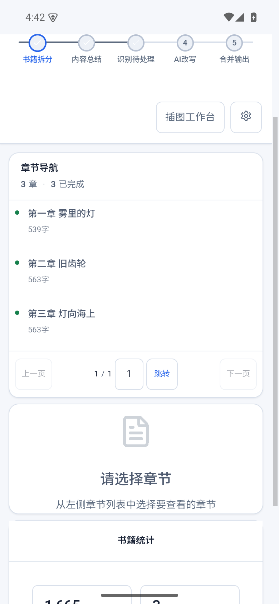

# 安装、模型与模板

[返回首页](../../README.md)

## 第一次使用

1. 从项目发行页安装 Windows x64 或 Android arm64 版本。已有安装可在“设置 → 应用更新”升级，无须卸载旧版。
2. 打开“模型配置”，添加至少一个文本模型。填写服务地址、密钥与模型 ID，获取模型列表或手动输入，然后测试连接。
3. 打开“提示词配置”，建立总结与改写模板，并设置默认选择。
4. 新建项目，导入 TXT，预览章节切分，选择模型、模板、工作模式和字数配置。
5. 先用少量章节验证输出，再开始整本处理。文本和绘图调用费用由所接入服务决定。

1.0.0 正式包不附带语音模型。阅读和创作不需要先下载语音模型，听书时再按需安装。

## 文本与图片模型分别配置

| 任务 | 配置要点 |
| --- | --- |
| 总结、识别、字数规划 | 选择文本模型，保证输入容量能覆盖当前章节 |
| 正文改写 | 可使用不同文本模型；输出容量需容纳替换正文 |
| 绘图提示词 | 选择文本模型与对应提示词模板 |
| 文生图 | 配置图像生成模型 ID |
| 图生图 | 配置支持参考图的编辑模型 ID；可与生成 ID 不同 |

文本连接支持 OpenAI 兼容 Chat Completions / Responses、Anthropic Messages 和 Ollama。按实际服务选择协议，不应只依据模型名称判断接口。温度、输出容量、思考深度、超时和重试间隔按界面及模型能力配置；不支持的能力不会因填写名称而自动具备。

图片尺寸、分辨率和参考图数量依据当前模型能力显示。连接测试用于验证服务连接，不等于完成一次图片生成。

## 模板怎样组织

模板由系统要求、总结要求、场景识别类别、通用改写要求、分类改写规则等组成。类别 ID 连接识别结果与对应改写规则；修改显示名称时应保持同一语义的 ID 稳定。可调整类别条件、启用状态及顺序，也可分别指定总结、改写和绘图模板。

去 AI 味示例：把“空泛议论”“重复解释”“生硬转场”设为识别类别，要求引用原句和位置；通用改写要求为“保持事实、人称与叙述顺序，以具体动作替代空泛评价，不添加无依据设定”；各类别规则再说明具体改法。它是一套可编辑方法，效果取决于模型、原文和模板。

模板支持导入、导出；遇到同名记录按界面选择重命名、覆盖或跳过。项目保存自己的配置快照，调整全局默认不应被理解为自动改写所有旧项目。

章节拆分支持常见章节编号及补充规则。先检查目录预览，尤其是序言、卷名和番外；当前使用教程按已验证的 TXT 导入编写。
