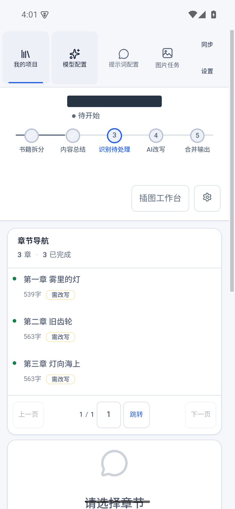

# 自动流程与场景改写

[返回首页](../../README.md)

## 两种工作方式

自动模式依次运行拆分、总结、识别、改写和输出；半自动模式用于分阶段检查总结、场景和结果，再推进后续处理。项目可以分别选择总结与改写模型、模板、并发数量及重试次数。

出现错误时先查看失败阶段和原因。已成功结果可按现有恢复规则复用，失败阶段重跑；停止后等待运行请求结束再调整设置。不要通过反复创建新项目代替错误排查。

## 识别与改写上下文

识别结果描述“哪些原文值得处理”，分类规则描述“应该怎样处理”。程序依据原文位置生成改写窗口，窗口外正文由程序保留。

以 A、B、C 三个场景为例：在当前调用处理 A、B 时，正文模型收到当前窗口的 A、B 分类规则、已审核证据及字数目标。1.0.0 不再额外附带整章识别清单。章节摘要、原有只读原文背景及邻接上下文继续用于连贯性；字数规划仍查看所有参与分配的场景。本次未改变场景合并与调用组织方式。

## 字数配置

| 设置 | 含义 |
| --- | --- |
| 章节计划加料总字数 | 本章初始新增字数预算，300～20000 |
| 每场景最低加料字数 | 默认 150；0 表示关闭保底 |
| 每场景最高加料字数 | 默认 0，表示不限；启用时不得低于最低值 |

上下限逐场景生效，调整后的合计可能与初始预算不同。目标描述的是新增字数，不是最终章节长度，也不是模型必定精确输出的字符数。详细规则见[字数预算说明](../rewrite-budget.md)。

## 去 AI 味与润色案例

先用模板识别重复表达、空泛情绪和突兀转场，再检查引用是否真的来自正文。设定适度预算，要求保留事件和人物关系，只对命中位置补充具体细节。完成后对照原文，检查是否添加了原文没有的动机或设定；不满意时调整对应规则后重新处理。

### 安卓：查看修改后的正文

在改写阶段选择章节，点击“查看对比”。安卓使用单栏展示修改后的文本，绿色标记帮助定位改动。

### Windows：左右对照

在同一入口查看原文和改写结果，电脑端左右两栏并排显示，便于逐段核对。

总结与场景定位异常可分别修复。识别数量统计覆盖项目已有有效结果；尚未完成总结的章节不应被理解为已确认无需改写。
