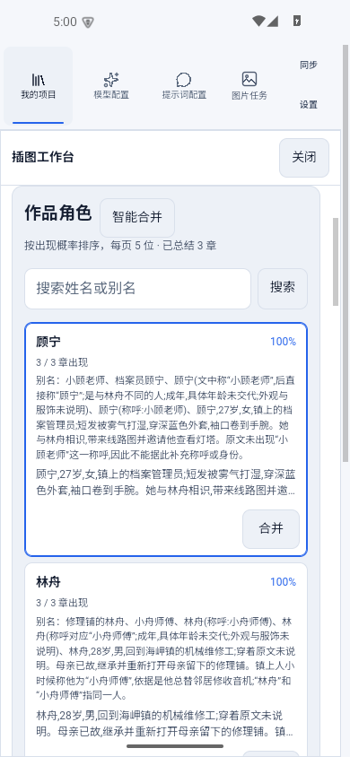
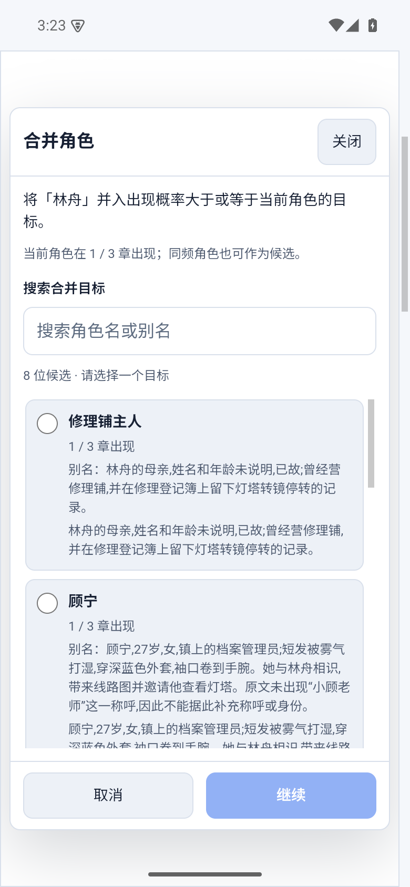
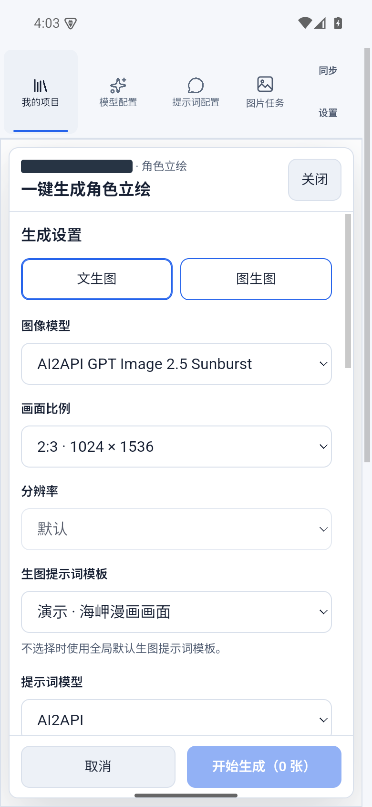

# 角色资料、合并与立绘

[返回首页](../../README.md)

## 先整理角色

插图工作台的“角色立绘”页从有效章节总结整理角色。出现率表示角色出现在已总结章节中的比例，便于筛选常驻人物；它不代表模型认定的主角地位。支持搜索姓名与别名、编辑描述、从总结刷新资料。

## 手动合并

点击待归并角色的“合并”，搜索目标角色并检查预览后确认。目标候选受到出现章节数量条件限制：目标出现次数应不少于来源角色。来源旧名作为别名保留，相关图片归入目标角色共同管理。

合并不会重新绘制旧图片。检查场景的角色选择与参考图；受角色变化影响的提示词草稿应重新确认或起草。

## 智能合并

1. 点击“智能合并”，选择文本模型、最低出现率及输入容量。
2. 启动分析，查看分批处理和汇总进度。关闭面板不等于取消运行；按界面恢复未完成分析。
3. 在建议中检查保留角色、候选别名和依据，取消不应合并的记录。
4. 确认所选建议，再检查角色库与立绘关联。

界面中的主要记录是合并后保留的角色条目，不等同于故事主角。模型建议需要用户审核，未勾选的条目继续独立存在。分析草稿保存在本机，正式角色合并结果随项目数据同步。

## 单张与批量立绘

可使用文生图，或选择已有图片进行图生图。文生图提供真人、国漫 3D、日漫、韩漫风格。批量生成可按出现率筛选、手动调整选择、配置并发与尝试次数，并跳过已有风格。

为需要参与场景图生图的角色设置主立绘。后续版本仍保存在资产库，可以预览、保存或切换主立绘；批量产生新版本后应主动检查并选择适合的主图。

