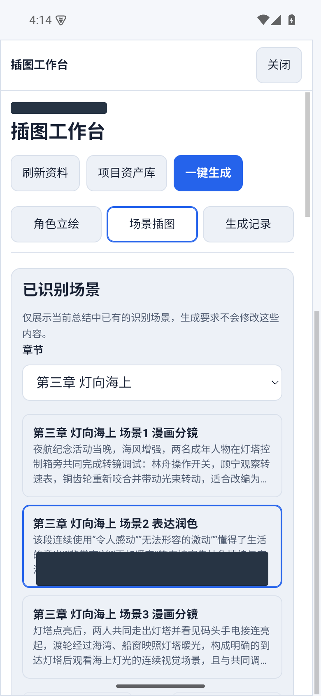
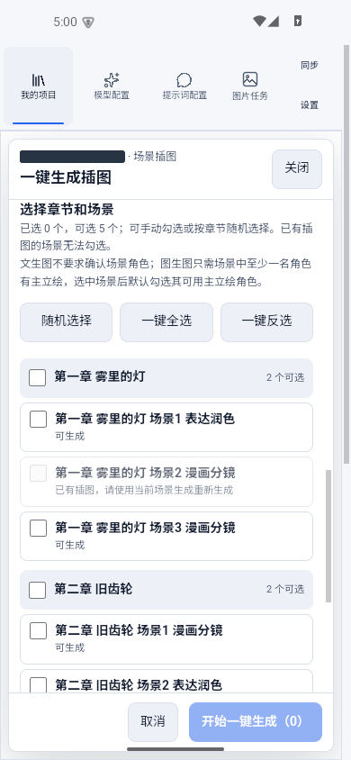
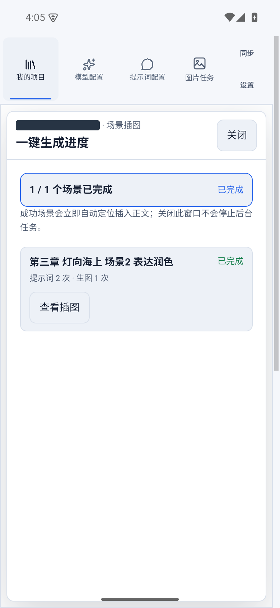
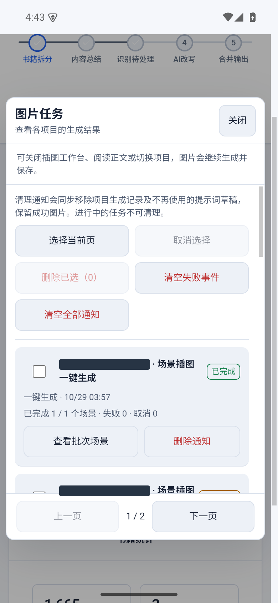
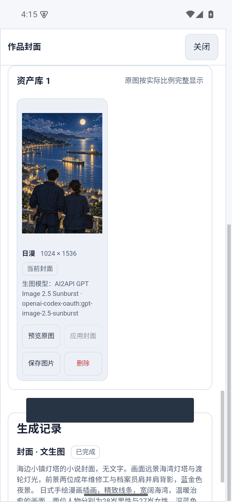

# 小说插图、漫画分镜与图片任务

[返回首页](../../README.md)

## 单场景插图

进入插图工作台，选择“场景插图”，再选择章节与已识别场景。核对场景事实，填写额外画面要求；生成要求不会修改原有识别结果。

文生图可直接指定风格。图生图需要确认出场角色及参考立绘，至少保留界面要求的有效参考；默认主立绘可以换成其他版本。选择绘图提示词模型、模板、图片模型和尺寸，起草并检查提示词后生成。提示词和生成记录可用于后续调整。

## 漫画案例

为半自动项目创建分镜识别模板，以每个画面可表达的剧情为单位，记录人物、动作、地点和对应原文，不凭空补充情节。先整理并合并角色，再生成主立绘，最后逐场景采用图生图。模板可约定构图、景别、对白位置和画风，但模型对文字、面部与服饰的一致性仍需检查。

## 一键为小说配图

“一键生成”中选择章节或场景，配置提示词与图片模型。图生图可调整各场景参考角色。已有图片的场景会依照界面规则跳过。

随机选择支持每章数量、本次总量、跳过已配图章节、必选角色及场景类型优先级。多个必选角色表示场景必须同时包含这些角色；不足时不会用不匹配场景凑数。先应用并检查选择，再开始生成。

成功图片自动定位插入正文。进度卡上的“查看插图”会进入对应章节和场景，并翻到、聚焦其资产卡；“返回生成进度”返回原批次列表位置。关闭进度面板不会停止后台任务；取消批次也不会删除已经生成的图片。

## 资产与任务管理

项目资产库按角色、章节、风格、主立绘或正文插入状态筛选。图片可预览原图、保存、应用封面、设置主立绘或插入正文；正文插图可调整插入位置及说明。移除正文插入关系与删除图片资产是不同操作，删除图片会影响其引用。

全局图片任务入口支持跨项目查看进度与错误，并打开对应工作台。结果未知时先核查，避免因重复提交产生重复费用。清理任务记录会同时清理相应生成记录及未被引用的提示词草稿，成功图片和正文插图仍保留；进行中的任务不能直接清理。

