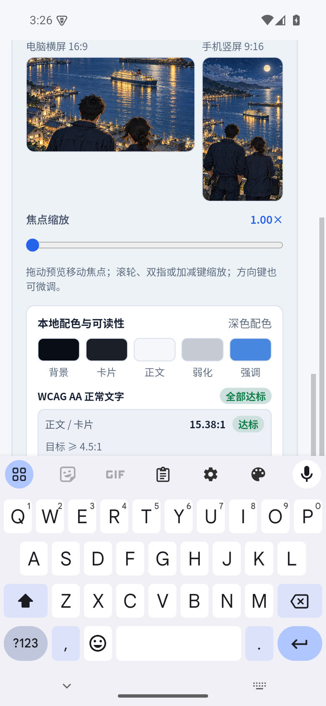
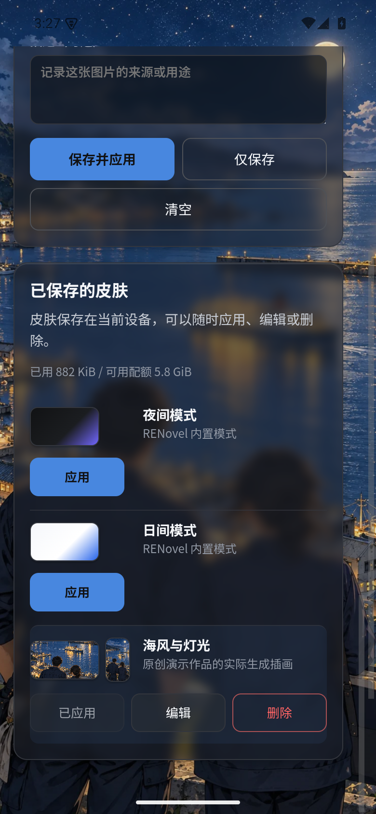

# 自定义皮肤

[返回首页](../../README.md)

## 选择外观

“设置”提供跟随系统、日间、夜间和自定义皮肤。自定义模式使用本地背景图片，并将配色应用于项目、模型、模板、同步、设置及工作台。

## 制作与保存

1. 上传 PNG、JPEG 或 WebP 图片，大小不超过 10 MiB。
2. 调整焦点与缩放，同时查看横屏和竖屏裁剪预览。同一焦点用于两个方向的预览。
3. 查看自动提取的配色及文字对比效果，避免背景遮挡正文。
4. 填写名称和说明，选择保存并应用，或仅保存到皮肤库。

已保存皮肤可再次应用、编辑和删除，当前选择在重启后保留。删除正在使用的自定义皮肤会回到默认深色外观。皮肤保存在当前设备，局域网项目同步不包含皮肤；需要在另一设备单独配置。

发布示例使用原创背景，演示中的文字和小说名称已脱敏。实际皮肤效果会随屏幕比例改变，应同时检查横竖预览。
