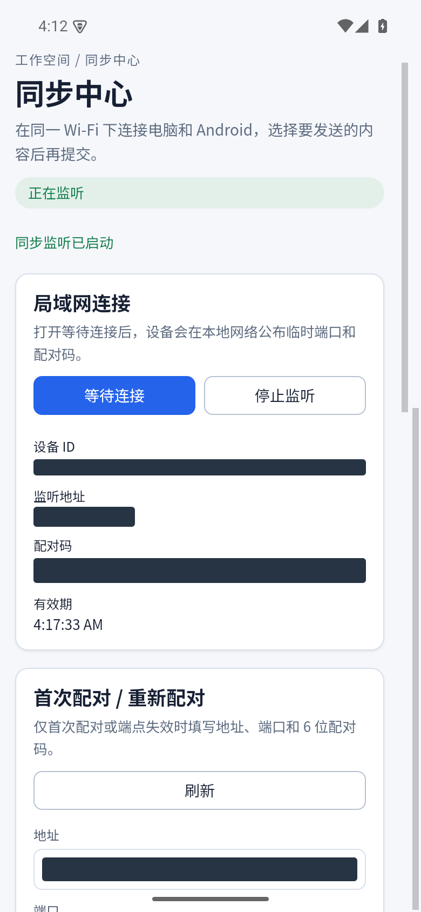
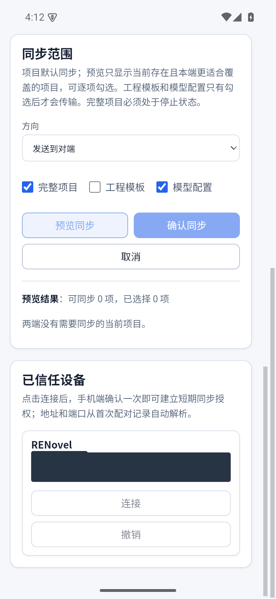
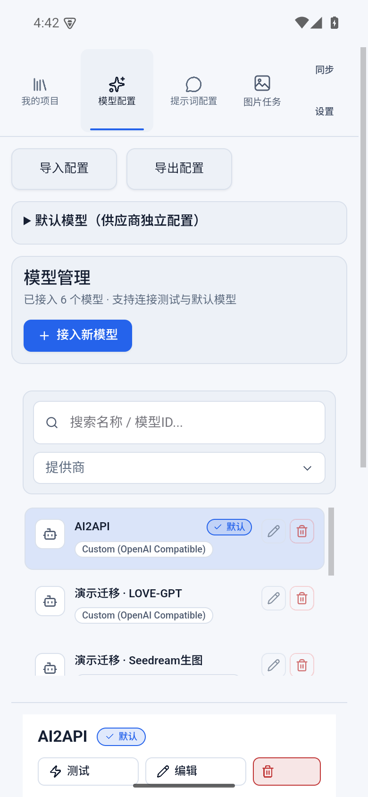

# 电脑手机同步与加密配置迁移

[返回首页](../../README.md)

## 同一局域网传输项目

1. 让电脑与手机连接同一局域网，打开双方“同步”页面。
2. 发现对方设备，或使用界面提供的地址和端口手动连接。
3. 按配对码完成连接确认；只信任自己的设备，之后可撤销信任。
4. 预览可传输内容，选择项目及需要附带的模型配置、模板。
5. 等待传输完成，在接收端打开项目检查章节、角色和图片。

同步是设备之间的局域网传输，不依赖项目云端托管，也不表示两台设备始终自动实时一致。传输前按预览检查已有内容和更新关系，修改后再执行需要的传输。

项目中的正式角色合并关系和图片随对应项目数据传输。自定义皮肤、语音模型及本机听书进度不在此项目同步范围内；另一设备需要自行下载语音模型。智能合并的未确认分析草稿保存在原设备。

## 只迁移模型和模板

模型或提示词管理页的配置迁移入口可导出加密配置包。设置密码后导出，在另一设备导入并输入密码，检查模型、模板和默认选择。

配置包包含所导出模型的连接信息及凭据，不包含小说正文。妥善保存密码和文件，不要公开上传配置包。此功能适合迁移配置；需要章节、角色和插图时使用项目同步。

连接失败时先检查两端是否位于同一网络、接收方是否正在运行、地址和端口是否正确，再检查系统防火墙及网络隔离设置。
