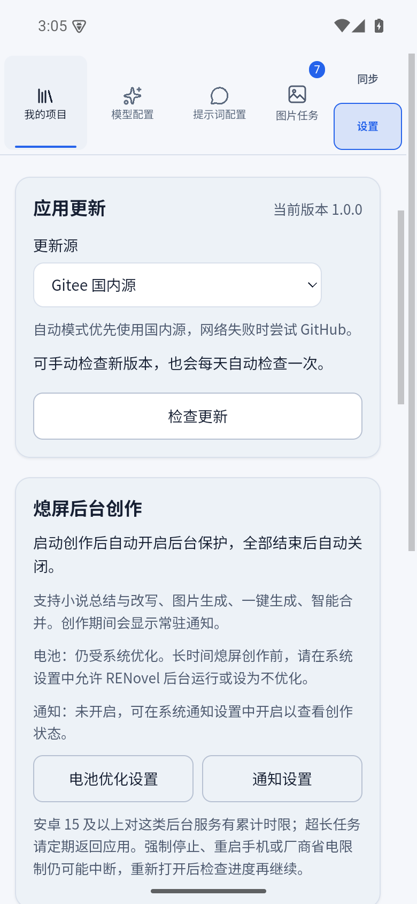
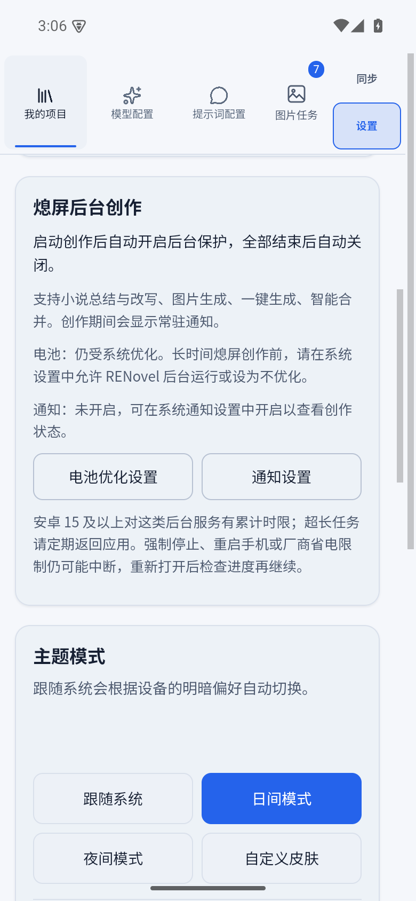

# 软件内更新、后台运行与常见问题

[返回首页](../../README.md)

## 后续升级直接在软件里完成

首次安装后，在“设置 → 应用更新”检查版本，下载完成后按提示安装即可，无需手动寻找新版本下载网址。

更新源可选择“自动选择（优先国内源）”“Gitee 国内源”或“GitHub”。自动模式优先检查国内源，并按既有规则在网络失败时使用另一来源；下载会验证文件大小、哈希及平台签名。软件不自动安装用户尚未确认的更新。

Windows 安装后重启应用；Android 打开系统安装器，需要用户确认安装以及系统要求的安装来源授权。取消不会卸载旧版。已有小说、配置、皮肤、语音模型和听书进度继续使用原有持久数据目录。

升级前保存正在编辑的内容并停止创作任务；未结束的请求或落盘会阻止安装。更新包是完整轻量包，下载失败后重新下载，不提供差分更新或断点续传。正式版不附带语音模型，已有模型无需再次下载。

## 手机熄屏创作

“设置”可查看后台创作保护、通知和电池优化状态，并打开对应系统设置。总结、改写、图片生成及智能角色合并等运行任务会使用现有后台保护机制，空闲后释放。

安卓系统的后台时间配额、Doze、厂商省电策略仍可能限制执行。强制停止应用或重启手机不等于安全暂停；软件不会自动重复提交可能收费的请求。重新打开后先检查实际进度及结果未知的任务。

## 常见问题

| 问题 | 处理方式 |
| --- | --- |
| 模型列表为空 | 检查地址和协议；服务不提供列表时手动填写模型 ID |
| 改写未达到目标字数 | 检查输出容量、原文长度、场景规则和最终分配；目标不保证模型精确输出 |
| 场景图生图没有参考人物 | 检查出场角色是否确认，以及角色是否设置主立绘 |
| 图片已经完成但没插入正文 | 先“查看插图”，再处理原文定位或手动插入 |
| 发现重复角色 | 使用手动合并，或智能合并后逐项审核 |
| 首次听书没有声音 | 先在“音色与模型”下载并安装，再试听检查 |
| 更新检查或下载失败 | 更换更新源并重试，保留旧版数据，不要卸载重装作为第一步 |
| 取消系统安装后仍显示安装中 | 退出并重新打开软件，再检查更新；取消不会删除旧版数据 |
| 同步找不到设备 | 检查同网、接收端运行状态、手动地址及网络隔离 |

## 备份

修改大量内容或升级前可备份应用持久数据。Windows 数据目录为用户目录下的 `.renovel-data`；先退出应用，再完整备份数据库及其伴随文件、图片和模型目录。不要仅复制正在写入的数据库，也不要将包含凭据的数据备份公开。Android 数据受系统应用目录管理，不要清除应用数据来处理一般网络故障。
